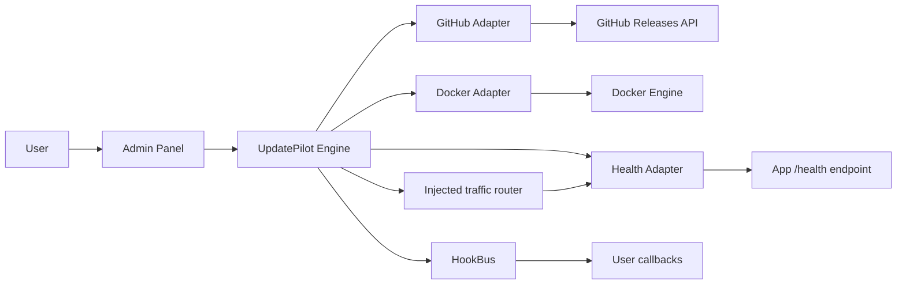

# UpdatePilot Architecture

## Overview

UpdatePilot follows an **adapter-first** design: release discovery,
container operations, and health verification are separate responsibilities
with provider-specific behavior contained at their boundaries. This lets the
engine coordinate an update without embedding GitHub or Docker details into
the application-facing API. It also gives future deployment targets a place
to integrate without changing the core lifecycle.

UpdatePilot is a **library, not a framework**. A Node.js application imports
it and chooses how to expose an update action in its own admin panel. The
application retains control of authentication, routing, and the surrounding
user experience; the library coordinates the configured release and
deployment operations.

The non-Compose Docker adapter can prepare a candidate while retaining the
previous container. Candidate-only health checks and traffic switching require
an application-provided `trafficRouter`; no router backend is bundled, and
zero-downtime behavior is not guaranteed by the package. Compose deployment is
currently rejected before Docker side effects.

## System Diagram



The admin panel initiates the operation through the application. The engine
uses adapters for external systems and sends lifecycle notifications through
the hook bus so application-owned callbacks can observe the process.

## Core Modules

| Module          | File                     | Responsibility                                                      |
| --------------- | ------------------------ | ------------------------------------------------------------------- |
| `UpdatePilot`   | `src/core/engine.js`     | Orchestrates the full update flow.                                  |
| `defineConfig`  | `src/core/config.js`     | Validates user configuration.                                       |
| `HookBus`       | `src/core/events.js`     | Emits lifecycle events.                                             |
| `GitHubAdapter` | `src/adapters/github.js` | Wraps `gh-release-update-notifier`.                                 |
| `DockerAdapter` | `src/adapters/docker.js` | Wraps `dockerode` for non-Compose deployment; rejects Compose mode. |
| `HealthAdapter` | `src/adapters/health.js` | Runs HTTP health checks with retry.                                 |

### Engine

`UpdatePilot` owns the sequence of operations and combines the adapter
results. It should not need provider-specific logic to decide whether to
continue, verify health, or restore the previous version.

### Configuration

`defineConfig` is the configuration entry point. It validates the repository,
version, Docker target, health check, cache, hooks, and rollback settings
before those values are used during an update.

### Adapters and Hooks

The GitHub, Docker, and health adapters isolate I/O with their respective
systems. `HookBus` provides lifecycle notifications to callbacks supplied by
the application, keeping application logging and alerting outside the core
deployment sequence.

## Update Lifecycle

The engine coordinates the following eight stages. The failure path is
explicit: health verification gates success, and failed verification leads
to rollback rather than a successful update response.

1. **`check()`** — The GitHub adapter queries the configured repository for
   its latest release.
2. **Compare versions** — The engine compares the release version with
   `currentVersion` using semver rules. If no newer version is available,
   deployment is not needed.
3. **Emit `beforeDeploy`** — The engine notifies the configured lifecycle
   callback before changing the running deployment.
4. **`deploy()`** — The non-Compose Docker adapter pulls the release image
   and starts a candidate on a dynamic host port while retaining the old
   container.
5. **`verify()`** — The injected router prepares a candidate-only health URL;
   the health adapter requests that URL using the configured retry policy.
6. **Switch and finalize** — After candidate health succeeds, the engine asks
   the injected router to switch traffic, then finalizes the Docker deployment.
7. **`rollback()`** — If preparation, health, or switching fails, the engine
   asks the provider to restore routing and rolls back the Docker candidate.
8. **Report rollback** — Emit `afterRollback` and return a failure result so
   the caller can report the unsuccessful update.

The hook callbacks surround the lifecycle rather than replacing its safety
checks. A callback can be used by the application for logging or alerting;
health verification remains the criterion for whether deployment succeeded.

## Adapter Contract

Every deployment adapter must provide `check()`, `deploy()`, and
`rollback()`. The methods are asynchronous so adapters can perform network
and container operations without blocking the Node.js event loop. Their
results give the engine the information it needs to proceed or recover.

```js
/**
 * Contract for an update provider used by the UpdatePilot engine.
 */
export class UpdateAdapter {
  /**
   * Check whether a version newer than the running version is available.
   * @param {string} currentVersion The currently deployed version.
   * @returns {Promise<{ updateAvailable: boolean, version?: string }>}
   */
  async check(currentVersion) {
    throw new Error("Implement check() in the adapter");
  }

  /**
   * Deploy the requested version.
   * @param {string} version The version to deploy.
   * @returns {Promise<{ success: boolean }>}
   */
  async deploy(version) {
    throw new Error("Implement deploy() in the adapter");
  }

  /**
   * Restore the requested previous version after an unsuccessful deployment.
   * @param {string} version The version to restore.
   * @returns {Promise<{ success: boolean }>}
   */
  async rollback(version) {
    throw new Error("Implement rollback() in the adapter");
  }
}
```

The contract separates the operation's intent from provider mechanics. The
current Docker adapter rejects Compose; future adapters can translate the
same operations to another runtime. Implementations should make failed
operations visible to the engine rather than silently treating them as
successful.

## Router Provider Conformance

Provider packages can import `defineTrafficRouterContractTests` from
`update-pilot/testing/traffic-router-contract` and supply a fresh, isolated
scenario for each test. The provider contract keeps the old route active during
preparation and candidate health verification. `prepare()` returns an absolute
HTTP(S) candidate-only health URL distinct from the deployment's live health
URL and an optional opaque context. The engine validates the URL's syntax,
protocol, and difference from the configured live URL; only a provider's
isolated route assertion can prove that the endpoint actually reaches only the
candidate.

If `prepare()` rejects before returning context, the provider cleans partial
work before rejecting; the engine also invokes idempotent rollback with
undefined context. `switch()` resolves only when the candidate route is active.
If switching partially changes routing and then fails, rollback must restore
the previous route. `rollback()` is idempotent and clears temporary state, so it
is safe after preparation/health/switch failures and repeated manual recovery.
When no previous route exists, rollback leaves the candidate unrouted.

This contract applies when an external `TrafficRouter` is injected. A custom
Docker adapter may instead own the handoff; when no router is injected, its
optional `DockerDeployResult.healthUrl` supplies the candidate health target
and the engine uses an internal no-op router. That path remains the adapter's
responsibility and is not certified by the provider conformance suite.

The scenario supplies the router and deployment data, checks candidate-only
health, verifies old-route preservation and candidate switching, confirms
rollback and preparation cleanup, and releases its test resources in
`cleanup()`.

These tests standardize observable behavior without binding the engine to a
proxy or control plane. They do not install a router, emulate production
credentials, or certify an application's topology; each provider project must
run them against its own isolated integration environment. UpdatePilot does
not currently bundle any router provider.

## Safety Principles

- **Retain the old image until verification passes.** Do not remove the
  rollback target while the new version is still being checked.
- **Require health verification for success.** Never return a successful
  update result before the configured health check passes.
- **Emit lifecycle hooks.** Always notify configured hooks so applications
  can record or alert on deployment and rollback activity.
- **Cache GitHub responses.** Reuse cached release data to avoid unnecessary
  GitHub API requests and reduce rate-limit pressure.

These principles keep recovery behavior visible and make a successful result
mean that the deployed version passed the configured check. The application
should still secure the route that initiates an update and choose a health
endpoint that reflects readiness to serve traffic.

## File Layout

```text
UpdatePilot/
├── package.json                 # Package metadata and exports
├── jsconfig.json                # JavaScript project settings
├── .gitignore                   # Local and generated files to ignore
├── .npmignore                   # Files excluded from the package
├── .editorconfig                # Shared formatting defaults
├── LICENSE                      # MIT license
├── CHANGELOG.md                 # Release history
├── src/
│   ├── index.js                 # Public API entry point
│   ├── core/
│   │   ├── engine.js            # Update flow orchestrator
│   │   ├── config.js            # Config loader and validator
│   │   └── events.js            # Lifecycle hook system
│   ├── adapters/
│   │   ├── github.js            # GitHub Releases adapter
│   │   ├── docker.js            # Docker adapter
│   │   └── health.js            # HTTP health-check adapter
│   ├── utils/
│   │   ├── logger.js            # Lightweight console logger
│   │   ├── retry.js             # Retry helper
│   │   └── errors.js            # Custom error classes
│   └── types/
│       └── index.d.ts           # TypeScript definitions
├── examples/
│   ├── config.sample.js         # Sample configuration
│   └── basic-express/
│       └── README.md            # Express example notes
├── test/
│   ├── engine.test.js           # Engine tests
│   └── adapters.test.js         # Adapter tests
├── .vscode/
│   └── settings.json            # Workspace editor settings
└── .github/
    └── workflows/
        ├── ci.yml               # Continuous integration workflow
        └── release.yml          # npm release workflow
```

The layout keeps public exports small, puts orchestration in `src/core`, and
places integrations in `src/adapters`. Tests mirror the main behavior areas;
examples show how an application configures and invokes the package.

## Future Architecture

- **Podman adapter:** add a container-runtime adapter that follows the same
  check, deploy, and rollback lifecycle.
- **Kubernetes adapter:** support deployments to Kubernetes while preserving
  health verification and rollback behavior.
- **Web UI widget:** provide a planned way to surface update status and
  actions in an application's admin interface.
