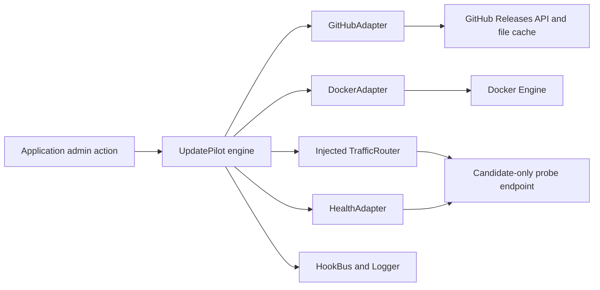
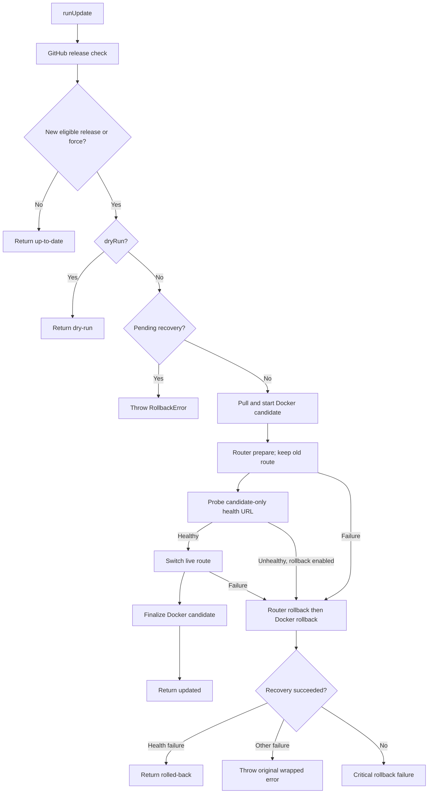

# Architecture and execution flow

UpdatePilot is an embedded Node.js library with an orchestration core, dedicated service adapters, an injected traffic-router boundary, hooks, logging, and typed errors. It exposes no HTTP endpoints itself. The application decides who may call its methods and how it persists deployment state.

## Lifecycle

This diagram describes the normal recovery path. When `rollback.enabled=false`, a health failure attempts router cleanup and throws without automatic Docker rollback. Other unexpected failures may also require operator recovery.

### Stage details

1. Resolve and deeply freeze config via `defineConfig`.
2. Lazily create GitHub, Docker, and health adapters as needed.
3. Compare latest eligible GitHub release against configured version; `checkOnly` ends here.
4. For a qualifying `runUpdate`, reject any pending unresolved rollback, then launch a Docker candidate while the old container is retained.
5. Build `TrafficRouterDeployment` and call `prepare()`; validate absolute HTTP(S) candidate URL, distinct from live URL when the router is injected.
6. Probe that **candidate** with retry/timeout policy and `beforeVerify` / `afterVerify` hooks.
7. Only after health success call `switch()`; then `finalize()` Docker state and return `updated`.
8. On prepare/switch failure, route rollback precedes Docker rollback; on health failure, follow the configured auto-rollback policy.

## Trust boundaries

- Root config knows repo, image, socket, health URL; no repository-owned admin authentication.
- GitHub adapter holds optional API token and caches results in a local file.
- Docker socket access provides powerful host privileges; isolate credentials and limit who may trigger updates.
- Router implementation is external: a syntactically distinct health URL alone does **not** certify that it points to a candidate container.
- Hooks are best effort; failures don't block lifecycle. Error serialization is not automatically safe for public clients.
- Recovery context and last results live in **one process**; durable transactions and multi-process locks are not implemented.

Read [Internal systems](internals.md), [Router integration](../guides/integration.md), and [Exceptions](../api/errors.md).